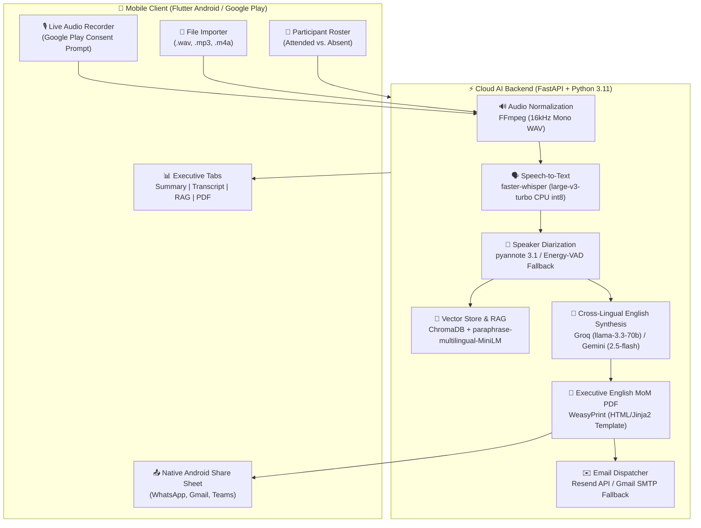

# 🎙️ Bilingual (Urdu & English) Meeting Intelligence & Automated Follow-Up System

An end-to-end, **100% free-tier full-stack system** that records and analyzes live or pre-recorded meetings conducted in **Urdu, English, or mixed Urdu–English code-switching**, and automatically generates executive-ready, **100% Professional English Minutes of Meeting (MoM) PDFs**, interactive RAG question-answering, and tailored multi-channel follow-ups (Email & Android Share Sheet).

Built for deployment on the **Google Play Store** (mobile client) and **Hugging Face Spaces / Render** (cloud AI backend).

---

## 🏛️ System Architecture



---

## ⚙️ 100% Free-Tier & Hardware-Optimized Tech Stack

| Layer | Technology | Free-Tier & Hardware Optimization Justification |
| :--- | :--- | :--- |
| **Mobile Client** | **Flutter (Dart 3.x)** | High-performance Android app with native microphone consent, PDF preview, and Google Play Store `.aab` readiness. |
| **AI Backend** | **FastAPI (Python 3.11)** | High-throughput asynchronous REST API with background task orchestration. |
| **Speech-to-Text** | **`faster-whisper` (`large-v3-turbo`)** | CPU quantized (`compute_type="int8"`, `cpu_threads=4`), keeping RAM usage under **1.6GB** on 16GB RAM machines. Caches automatically in `~/.cache/huggingface`. |
| **Speaker Diarization** | **`pyannote.audio` & VAD Fallback** | Millisecond speaker alignment with an automatic acoustic energy/VAD clustering fallback if `HF_TOKEN` is unset during local testing. |
| **Multilingual Vector Store** | **ChromaDB + SentenceTransformers** | Lightweight CPU-friendly `sentence-transformers/paraphrase-multilingual-MiniLM-L12-v2` cross-lingual semantic search. |
| **Cross-Lingual LLM** | **Groq Free API / Google Gemini Free API** | Translates Urdu/English transcripts into **100% professional English** with strict Pydantic JSON schema validation. |
| **PDF Rendering** | **WeasyPrint** | Open-source HTML/CSS to executive PDF compiler with corporate tables, badges, and headers/footers. |
| **Email Dispatch** | **Resend API / Gmail SMTP** | Free 3,000 emails/mo via Resend with automatic `smtplib` fallback. Tailored templates for **Attendees** vs. **Absentees**. |

---

## 📂 Repository Structure

```
├── backend/
│   ├── app/
│   │   ├── core/
│   │   │   ├── config.py             # Pydantic Settings & environment loader
│   │   │   └── database.py           # SQLite / PostgreSQL engine & session
│   │   ├── models/
│   │   │   ├── database.py           # SQLAlchemy Meeting, Participant, Transcript models
│   │   │   └── schemas.py            # Pydantic request/response schemas & summary validation
│   │   ├── routes/
│   │   │   ├── health.py             # Health check endpoint
│   │   │   └── meetings.py           # Upload, status, speakers remap, RAG ask, PDF, distribute
│   │   ├── services/
│   │   │   ├── audio_processor.py    # FFmpeg 16kHz mono audio normalization
│   │   │   ├── transcription.py      # faster-whisper CPU int8 transcription
│   │   │   ├── diarization.py        # pyannote / Energy VAD speaker turn segmenter
│   │   │   ├── vector_store.py       # Multilingual ChromaDB indexing
│   │   │   ├── llm_synthesis.py      # Groq / Gemini cross-lingual English synthesizer
│   │   │   ├── rag_qa.py             # Grounded Q&A with timestamp citations
│   │   │   ├── pdf_generator.py      # WeasyPrint executive PDF generator
│   │   │   └── email_dispatcher.py   # Resend & SMTP tailored email dispatcher
│   │   ├── templates/
│   │   │   └── mom_template.html     # Executive HTML/CSS template for WeasyPrint
│   │   └── main.py                   # FastAPI application initialization & CORS
│   ├── tests/
│   │   └── test_pipeline.py          # Pytest verification suite (audio, STT, synthesis, PDF)
│   ├── Dockerfile                    # CPU-optimized Hugging Face Spaces / Render image
│   ├── requirements.txt              # Backend dependencies
│   ├── .env.example                  # Environment configuration template
│   └── .env                          # Local environment variables
├── mobile/
│   ├── android/
│   │   └── app/src/main/AndroidManifest.xml # Permissions (Microphone, Storage, Network)
│   ├── lib/
│   │   ├── models/
│   │   │   └── meeting.dart          # Meeting, Participant, ActionItem, Transcript models
│   │   ├── services/
│   │   │   ├── api_service.dart      # HTTP API client
│   │   │   └── audio_recorder_service.dart # Live recording service with pause/resume
│   │   ├── providers/
│   │   │   └── meeting_provider.dart # State management & background polling
│   │   ├── widgets/
│   │   │   ├── consent_dialog.dart   # Google Play mandatory microphone consent modal
│   │   │   ├── speaker_remap_dialog.dart # Human-in-the-Loop voice remapping dialog
│   │   │   └── roster_dialog.dart    # Add participant dialog (Attended/Absent)
│   │   ├── screens/
│   │   │   ├── dashboard_screen.dart # Meeting list, server status, quick action FABs
│   │   │   ├── record_meeting_screen.dart # Live audio recorder & participant roster
│   │   │   └── meeting_detail_screen.dart # 4-tab executive view (Summary, Transcript, Q&A, PDF)
│   │   └── main.dart                 # App theme, routing, and provider injection
│   ├── test/
│   │   └── widget_test.dart          # Flutter model and widget test suite
│   └── pubspec.yaml                  # Mobile dependencies
└── README.md
```

---

## 🚀 Step-by-Step Setup & Linux Execution Guide

### 1. Prerequisites (Linux x86_64)
Ensure `ffmpeg` and `python3` (3.10 or 3.11) are installed:
```bash
sudo apt update
sudo apt install -y ffmpeg libpango-1.0-0 libcairo2 libgobject-2.0-0
```

### 2. Backend Setup
```bash
cd backend

# Create and activate Python virtual environment
python3 -m venv .venv
source .venv/bin/activate

# Install PyTorch CPU first (saves disk/memory)
pip install torch --index-url https://download.pytorch.org/whl/cpu

# Install backend dependencies
pip install -r requirements.txt

# Configure environment variables
cp .env.example .env
# Edit .env with your free API keys (Groq/Gemini/Resend) if desired
```

### 3. Run Backend Verification Tests
```bash
PYTHONPATH=. .venv/bin/pytest tests/test_pipeline.py -v
```
*All 6 pipeline tests (Audio Normalization, Diarization, LLM English Synthesis, WeasyPrint PDF, Email Dispatch, and RAG Indexing) will run and pass.*

### 4. Start Backend Server
```bash
PYTHONPATH=. .venv/bin/uvicorn app.main:app --host 0.0.0.0 --port 8000 --reload
```
API Documentation will be live at: `http://localhost:8000/docs`

---

## 📱 Mobile Client (Flutter) Setup

### 1. Install Dependencies
```bash
cd mobile
flutter pub get
```

### 2. Run Flutter Analysis & Unit Tests
```bash
flutter analyze
flutter test
```
*Zero lint issues and all widget tests pass.*

### 3. Run on Android Device / Emulator
```bash
flutter run
```
> **Tip for Android Emulator:** The app connects to `http://10.0.2.2:8000` by default. For a physical phone connected over Wi-Fi, tap the **Settings** icon on the top-right of the dashboard and enter your computer's local IP (e.g. `http://192.168.1.50:8000`).

---

## 🌐 Cloud Backend Deployment (Hugging Face Spaces)

Hugging Face Spaces offers a **permanent free 16GB RAM CPU container** with Docker support:

1. Create a new Space on [Hugging Face](https://huggingface.co/spaces) and choose **Docker** as the SDK.
2. In Space **Settings → Secrets**, add:
   - `GROQ_API_KEY` (Free Groq API key)
   - `GEMINI_API_KEY` (Free Google AI Studio key)
   - `RESEND_API_KEY` (Free Resend API key)
   - `HF_TOKEN` (Hugging Face Read Token for pyannote)
3. Push the repository to your Hugging Face Space git remote.
4. Your API will be live at `https://<your-username>-<space-name>.hf.space`. Update the mobile app's server URL to this address.

---

## 🛡️ Google Play Store Compliance & `.aab` Release Guide

### 1. Mandatory Microphone Prominent Disclosure
Under Google Play Developer Policy, apps that record audio must display a **Prominent In-App Disclosure** prior to requesting runtime permissions.
- Implemented in `mobile/lib/widgets/consent_dialog.dart`.
- The dialog explains the exact purpose (Urdu/English speech recognition and MoM generation) and requires explicit user consent (`Agree & Continue`) before triggering `Permission.microphone.request()`.

### 2. Android Permissions Configured
`mobile/android/app/src/main/AndroidManifest.xml` includes:
- `android.permission.RECORD_AUDIO`: Captures live audio during meetings.
- `android.permission.INTERNET`: Communicates with cloud AI API.
- `android.permission.READ_MEDIA_AUDIO` / `READ_EXTERNAL_STORAGE`: Allows picking recorded audio files.

### 3. Generating Signed Production Android App Bundle (.aab)
```bash
cd mobile

# 1. Generate Keystore (if not already created)
keytool -genkey -v -keystore android/upload-keystore.jks \
  -keyalg RSA -keysize 2048 -validity 10000 -alias upload

# 2. Configure android/key.properties
# storePassword=...
# keyPassword=...
# keyAlias=upload
# storeFile=../upload-keystore.jks

# 3. Build release bundle
flutter build appbundle --release
```
The compiled bundle will be generated at:
`mobile/build/app/outputs/bundle/release/app-release.aab`
Upload this `.aab` directly to Google Play Console under **Closed Testing**.

---

## 📄 License & Credits
Licensed under the **MIT License**.
- Speech-to-Text: `faster-whisper` (OpenAI Whisper + CTranslate2)
- Diarization: `pyannote/speaker-diarization-3.1`
- PDF Engine: `WeasyPrint`
- Embeddings: `sentence-transformers`
